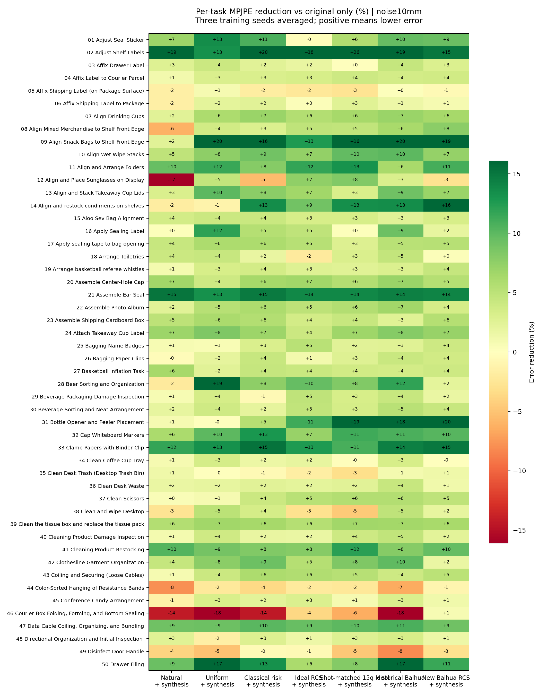
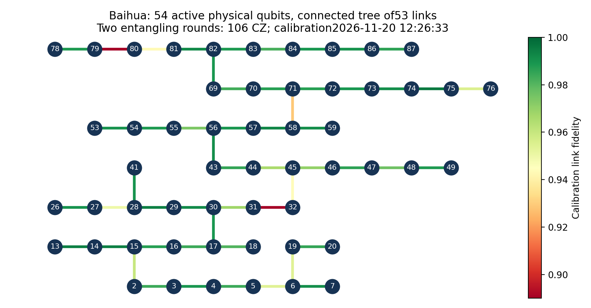

# 决赛进展：EgoDemo 50任务与Baihua真机

2026-11-20。[项目统一页面](http://8.153.83.178:6222/qtail-embodied.html)融合原站架构与当前证据，沿用深色青紫视觉。决赛PPT由本机私下交付，不在公开站点或当前仓库文件中提供下载。此页记录新运行结果，源数据不是完整10万小时。

## 数据、合成与比较

- 从 LightwheelAI/EgoDemo 固定 revision `407b960db2fe1c91b75854848d49c5cf920f68b9` 选择字母序50个任务，每任务1条完整状态Parquet；覆盖42个官方scene_id、161,692帧、270,112,215字节，约1.50小时。官方帧数、任务名、scene_id全部一致；坐标有限、时间戳递增。本地SHA256保留在校验报告；不声称提供方哈希匹配。
- 8个学习臂各3组重复，共24次训练；另含保持上一帧姿态、恒速预测两个强基线。训练前冻结协议。每臂60,000行训练库、相同残差MLP、batch256、1,200次更新。增强臂各30,000原始与30,000合成窗口，共630,000条合成窗口；重采样行与同源变体不等于独立episode。
- 用3帧42关节预测5帧后坐标。每episode按时间60%/15%/25%划分，边界隔离；归一化、任务风险与稀缺度只用训练区间。风险是恒速残差与训练窗口稀缺度代理，没有伤害标签。
- 增强包括共享刚体旋转±10°、平移±1cm，以及PT-OT目标 `0.9 Beta(2,5)+0.1 Beta(5,2)` 的逆分位映射，生成1–30mm每手共享观测噪声。所有增强臂使用同一类变换；量子计数仅控制任务分配 `q=0.4b+0.6P_matched`。这是人手坐标/观测窗口合成，不是视频、机器人动作或物理接触仿真。

10mm观测噪声下，新Baihua5q分配加增强相对原始神经网络：

| 指标 | 原始 | 新Baihua+增强 | 改变 |
|---|---:|---:|---:|
| 任务宏平均MPJPE（cm） | 3.746 | 3.556 | 降低5.09% |
| 每任务P95宏平均（cm） | 6.995 | 6.943 | 降低0.74% |
| 训练窗口最少10任务误差（cm） | 3.961 | 3.603 | 降低9.04% |
| 最差20%任务误差（cm） | 5.226 | 5.110 | 降低2.22% |
| 预测误差≤5cm帧占比 | 80.12% | 81.74% | +1.61pp |

45/50任务的平均位置误差改善。固定50条episode和已观察3组硬件/训练配对重复下，任务bootstrap95%误差降低区间为3.68%–6.63%；不是新episode或新硬件运行的保证。测试窗口重叠，不当作独立样本。

新Baihua相对经典风险加权仅降低0.22%，差异区间跨零。保持上一帧姿态基线为3.331cm，仍优于当前神经网络。干净观测下，平均误差降低1.23%但区间含零，5cm内占比下降0.54pp。没有建立量子优势、机器人成功率或安全收益。所有任务、负结果与全部条件均见[逐任务CSV](../results/finals_50tasks_20261120/ablation/per_task_metrics.csv)。



## 本次新真机：仅Baihua

| 实验 | Task ID | 实际shots | 执行时间（北京时间，11-20） |
|---|---|---:|---|
| 5q seed7 r0 | 2611201314459691297 | 2048 | 14:15:08–14:15:13 |
| 5q seed7 r1 | 2611201318089732111 | 2048 | 14:15:13–14:15:17 |
| 5q seed7 r2 | 2611201318096790351 | 2048 | 14:15:17–14:15:22 |
| 54q拓扑规模验证 | 2611201432184387939 | 4096 | 14:32:19–14:32:26 |

全部Finished，API与任务页已复核。用户导出的3份5q CSV的96个概率值可精确还原API整数计数；54q CSV的4096条54bit计数也全部一致。

5q沿用用户参考线路：5H+30Ry+24CX，编译49U+24CZ，含测量QASM依赖层22→30。三次逻辑和编译线路散列相同；每次硬件重复分别配训练seed0/1/2，没有独立拆解硬件与训练方差。理想线路已用独立SDK状态向量结果核对。

54q根据当日12:26:33校准图选54节点连通子树，两轮106CZ。编译后54个活跃物理比特、54个测量、162U+106CZ，QASM依赖层11→10。`qreg[88]`来自最大物理编号87，不代表88个活跃比特。4096次测量全部为不同串，各1次，所以观测柱图等高；这不证明真实分布均匀、保真度、Porter–Thomas形态或经典困难性。浅树线路也不能仅凭54比特声称量子优势。54q验证规模，不是前述5.09%下游增益的来源。



另外重新取回核验了4月的6份Baihua历史PT结果；3个同线路99,328shot重复合计297,984shots，单列为历史对照，未替代本次新提交。审计包含原始/编译QASM、计数、时间、散列和门计数。依赖层是QASM的门依赖层，不是脉冲执行时长。

## 存储估算

样本字节/样本时长×100,000小时：状态约18TB、单左目约362TB、完整一份LeRobot约754TB；完整包加20%工作空间约905TB，建议约1PB可用主存储，冗余与独立备份另加。50任务非随机，任务bootstrap约705–810TB只反映样本变动，不涵盖全量SKU码率偏差。LeRobot和MCAP可能是同episode的替代表示，不能重复累加小时。不是提供方全量精确清单。

## 痛觉与VLA/WAM

保留痛觉记忆连接组结构审计及架构，不复用缺实验支持的+6.8pp等旧稿数字。VAL+WAM的Allegro/Shadow扰动reach局部仿真可复用环境、模型运行时、动作投影与回归门禁；没有证明与Q-TAIL融合增益，正式OpenVLA未在无CUDA环境运行。人到机器人映射、伤害标签、接触仿真和真实执行仍是下一步。

## 复现

Python环境需要numpy、scipy、torch、pyarrow、pandas、matplotlib；真机接口使用pyquafu和quark。需要本人获得EgoDemo访问权，数据由许可渠道获取。下载器现默认获取50条完整episode的全部450文件；`--state-only`才是只取状态的显式选项。双目视频、标注和全部LeRobot元数据在同一固定revision下下载，按源内容散列校验，并提供视频全帧解码检查。公开仓库只含方法、元数据、计数与指标，不重新分发受限源轨迹、训练库或凭据。

```bash
python3 tools/qtail_egosuite_pose50_download.py --root /Volumes/ORICO/qtail_full_data_10w
python3 tools/qtail_verify_full50.py --root /Volumes/ORICO/qtail_full_data_10w
python3 tools/qtail_collect_egosuite_pose50.py --root /Volumes/ORICO/qtail_full_data_10w
python3 tools/qtail_baihua_archive_analyze.py
python3 tools/qtail_pose50_ablation.py --root /Volumes/ORICO/qtail_full_data_10w --arms original_only,natural_aug,uniform_aug,classical_risk_aug,ideal_rcs_aug,ideal_archive_aug,baihua_archive_aug,baihua_rcs_aug
python3 tools/qtail_pose50_analyze.py
```

新真机运行器为`tools/qtail_baihua_finals_run.py`与`tools/qtail_baihua_large_run.py`，凭据从本机`QUAFU_TOKEN`读取。现有回执存在时只查询，不重复提交。删除回执并执行会触发新任务，评分核查不要求重跑。协议、任务清单、原始计数和审计见`results/finals_50tasks_20261120/`。
