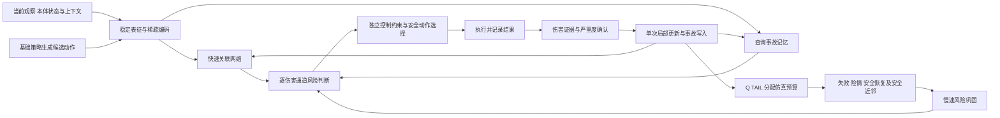

# Q-TAIL 单次事故记忆网络与果蝇连接组验证设计

日期：2026 年 10 月 10 日。状态：架构与公开数据结构核验已完成；学习动力学、行为收益和机器人实验尚未验证。

目标是在一次经确认的严重事故之后，无需再次遭遇事故、无需等待基础策略梯度更新，从下一次决策开始规避同一危险状态与动作。果蝇连接组提供结构约束，工程事故记忆提供持久存储，两者的贡献需要分别测量。单次写入、跨场景泛化、长期保持是三个独立目标，不能相互替代。

## 科学依据与问题定义

用户提到的约 16.7 万神经元对应 MaleCNS 雄性果蝇完整中枢神经系统，覆盖大脑及腹神经索。官方 v1.0 于 2026 年 6 月发布，论文于 2026 年 9 月发表。项目采用 v1.0 数据，而不是约 14 万神经元的早期雌性全脑数据。来源：[MaleCNS 项目](https://male-cns.janelia.org/)、[版本记录](https://male-cns.janelia.org/release/)。

2019 年的一项成年果蝇研究发现，单次训练可产生立即形成、至少保持 14 天的上下文依赖记忆；检索需要恢复气味及训练环境线索，涉及侧角回路。这支持研究快速记忆，但不证明终身记忆、任意条件下的泛化或机器人安全。实验中的“单次训练”也不能自动解释为单个电击脉冲。来源：[Zhao 等，Nature Communications，2019](https://www.nature.com/articles/s41467-019-12436-7)。

果蝇蘑菇体的多巴胺信号参与学习与记忆更新，短期和长期回路有不同动力学。它不是一个完全没有强化信号的系统。来源：[Huang 等，Nature，2024](https://www.nature.com/articles/s41586-024-07819-w)。常规厌恶条件化中的单次会话记忆也可能在数小时内衰减，间隔重复可支持长期巩固。来源：[Francés 等，Nature，2026](https://www.nature.com/articles/s41586-026-10306-z)。

强化学习并不在数学上要求同一惩罚必须出现多次；表格更新、情景记忆及模型式方法都能利用单次经验。这里针对的瓶颈是大模型的小步梯度更新、事故信号稀释及遗忘。公平实验必须包含具有外部记忆的强化学习基线。

## 系统架构

工作名称为“单次事故记忆网络”。这是一个混合系统：局部可塑性神经网络负责快速关联，可检索的事故库负责持久保持，基础策略负责技能。以下结构是工程设计，不是已确认的完整果蝇痛觉回路。



### 稀疏场景和动作编码

输入包含事故前一段时间的观察、候选动作块、接触和本体信号，以及材料、温度、负载、速度等与危险机制有关的上下文。视觉外观变化不能直接等同于危险机制变化。

表示为 `z_t = Encoder_v(o_<=t, x_<=t, context_t, action_candidate)`，再做稀疏竞争编码 `k_t = TopK(ReLU(W_in z_t))`。`Encoder_v` 在第一阶段冻结，并记录版本。若更新编码器，保留事故原始片段，在迁移索引后通过历史事故检索测试，防止“数据还在但找不到”。

果蝇对照：Kenyon 细胞提供稀疏关联表征；APL 提供竞争抑制的研究约束。机器人的输入接入方式和编码参数仍是工程假设，需要消融。

### 即时伤害门与事故前资格迹

每个伤害主体单独建模，不把碰撞、物体损坏、机器人损伤和人员风险全部合成一个标量。第一阶段以仿真损伤标签及标定的接触阈值触发，不等待尚未训练好的 PainNet 自我判定。

事故写入门：

```text
write = confirmed_evidence AND severity >= permanent_threshold
```

不确定异常进入临时记录，后续证据决定升级或撤销；立即保护控制与永久记忆写入使用不同判定。必须防止一次传感器噪声形成永久错误关联。

资格迹保存伤害前活动，解决结果延迟出现时的归因：

```text
e_ij(t) = exp(-dt / tau_e) * e_ij(t-1) + k_i(t) * m_j(t)
delta_W_ij = eta_fast * d_j(t) * e_ij(t)
```

`d_j` 是带确认度的局部厌恶调制信号；`m_j` 是相关输出单元的活动。更新只作用于允许可塑的连接，局部规则的符号、饱和与时间窗按不同回路设定。不能从突触数量直接推导其功能符号或可塑性规则，也不能假设每个 PPL1 神经元都负责伤害。

该式是待验证的三因素学习规则候选。事故前推断只使用当时可获得的信号；事故后的损伤标签仅用于写入与学习，不进入事故前预测，以免形成未来信息泄漏。单次事件内的多个时间步与多次独立事故暴露也要分别记账。

### 单次事故持久记忆

写入记录包含 `incident_id, encoder_version, pre_event_sequence, action, context, harm_channel, severity, confidence, sensor_evidence, timestamps`。写入成功须经过落盘与读回确认，记录采用追加写入；修正或解除由新版本记录表达，普通策略训练不能直接覆盖。

风险检索同时匹配状态、动作和必要上下文：

```text
R_memory(z,a,c) = max_i severity_i * confidence_i
                  * K_state(z,z_i) * K_action(a,a_i) * K_context(c,c_i)
R_j = max(R_memory,j, calibrated_R_predictor,j)
```

各核函数采用经校准的相似度，不仅比较整张图像。危险的“偏斜插入＋继续加力”必须与安全的“同一零件＋对齐后慢速插入”区分；高严重度也不能无限扩张成所有插入动作的禁令。

条件性保证：若同一事件的输入仍可被相同版本编码器检索、事故确认与落盘成功、危险候选超过固定风险阈值且执行器服从门控，下一次该候选可被阻断，无需策略梯度更新。此保证不涵盖未知表征、全新动力学、因果误判或失效硬件。

“长期保持”是持久数据、版本兼容与回归检查的工程属性。不能仅凭一条不衰减权重证明终身记忆。

### 动作选择与慢速巩固

基础策略提出多个动作，风险模块筛选并重排，独立控制约束拥有最终控制权。高风险时选择重新观察、减速、改变姿态或恢复动作；恢复动作本身也须评估风险。没有合格动作时停止。评测同时记录任务完成，避免用静止策略取得低伤害率。

一次事故可在内部仿真产生多种变体：同机制不同外观的危险样本、险情、安全恢复、外观相似但安全的困难负样本。真实事故次数保持为一，但内部生成和训练次数必须报告，不能把这一过程描述为“整个系统只训练了一次”。

Q-TAIL 仅负责离线仿真、回放与数据收集的预算分配。风险桶使用稀有度、严重度、不确定性及剩余学习缺口，并保持正常场景覆盖上限和下限。PT 先验不携带危险语义，也不参与必须立即完成的事故写入；单次写入能力首先在没有 PT 的条件下验证。

## 如何使用 MaleCNS 验证

### 已执行的公开数据结构核验

数据来自官方 v1.0 注释，以及作者补充仓库的雄性与雌性中央脑类型组连接对照。补充仓库已固定到提交 `67767d2233657983993ff6c2be48e836a935863c`，下载文件记录 SHA-256。来源：[官方数据入口](https://male-cns.janelia.org/download/)、[作者补充仓库](https://github.com/flyconnectome/2025malecns)。

本次核验重现 166,700 个带 `superclass` 标签的神经元；注释文件共有 211,577 个片段记录，不能把包含胶质与孤立片段的总行数当成神经元数。学习回路候选计数：

| 类别 | 神经元数 |
| --- | ---: |
| Kenyon 细胞 | 4,064 |
| 蘑菇体输出神经元 MBON | 97 |
| 全部 DAN 注释 | 340 |
| PPL1 类型候选，属于上述 DAN | 16 |
| PAM 类型候选，属于上述 DAN | 316 |
| APL | 2 |

类型组连接表中，雄性侧的正权重连接包括：

| 方向 | 类型组连接数 | 合计化学突触数 |
| --- | ---: | ---: |
| KC 到 MBON | 254 | 463,221 |
| PPL1 到 KC | 51 | 49,216 |
| PPL1 到 MBON | 132 | 11,041 |
| MBON 到 PPL1 | 133 | 4,353 |
| PAM 到 KC | 112 | 173,708 |
| KC 到 APL | 12 | 210,287 |
| APL 到 KC | 12 | 196,098 |

这确认了候选学习回路的类别与方向性连接可从真实公开数据提取。该导出按跨样本匹配的中央脑类型组聚合，并排除了腹神经索连接。它不是逐个神经元的连接表，也不是整个 166,700 神经元网络的动态仿真。连接存在不能直接证明厌恶功能、单次学习、长期保持或机器人收益。

可复现核验：

```bash
python3 tools/qtail_audit_fly_memory_circuit.py \
  --annotations /Users/avalok/.cache/qtail_pain_fly/malecns_v1/body_annotations.feather \
  --type-edges /Users/avalok/.cache/qtail_pain_fly/malecns_v1/type_edges.feather \
  --manifest /Users/avalok/.cache/qtail_pain_fly/malecns_v1/download_manifest.json \
  --out results/qtail_fly_memory_design
```

数据处理需要 `pandas`、`numpy` 和读取 Feather 的 `pyarrow`；本次已用现有环境执行。原始文件保存在缓存，未向项目加入约 115 MB 的原始数据。

### 第一层 验证生物学习回路假设

先提取逐神经元的 KC、MBON、DAN、APL 及相关输入和输出子图，再单独扩展与上下文有关的侧角回路。官方全部连接表或经过认证的 neuPrint API 可提供逐神经元数据；目前导出的类型组表仅用于接入可行性核验。

以连接组定义允许的连接及数量约束，以生理数据约束正负作用、时间常数、调制和可塑性。优先采用稀疏速率模型，只有在速率模型通过行为与活动对照后才增加脉冲动力学复杂度。不要为“神经元数更大”直接仿真整个 CNS。

实验使用模拟气味 A、气味 B、上下文 X、上下文 Y，以及模拟厌恶刺激：先测初始偏好，再仅将 A 与厌恶事件配对一次，立即在无厌恶刺激条件下测试 A/B 的选择。分别测试同上下文与换上下文、未配对刺激以及无刺激组。工程事件的“单次”定义为一次独立环境遭遇；若复现文献会话，应按原始脉冲时序另设实验臂。

此层不接入工程永久记忆库。比较真实子图与保留度数/权重分布的随机重连子图、移除调制、移除可塑性、移除上下文输入及移除反馈的模型。参数只在独立的训练条件上拟合，留出气味、上下文和损伤族用于评测。必须对突触置信阈值、作用符号假设与时间常数做敏感性分析。

通过条件是单次配对后对 A 的选择发生稳定改变，同时 B 与安全行为保持，并在留出条件上接近可获得的生理/行为数据。长期性要对照真实实验时间与记忆衰减参数；没有经校准的时间映射时，模拟步数不能换算成“14 天”。

若加入外部持久记忆后才产生保持，只能说明工程持久记忆有效，不能声称连接组本身产生终身学习。若随机重连具有同样效果，则缺少果蝇特定拓扑提供额外收益的证据。

### 第二层 验证单次事件工程记忆

固定基础技能模型，比较纯梯度风险学习、局部可塑性、外部情景记忆，以及局部可塑性加情景记忆四组。所有组先获得相同的通用表征和安全技能数据；留出测试危险族，允许每组仅观察一次相同事故，冻结新增事故采集。

立即测量下一次相似场景的危险选择概率；随后只训练无关任务，再检验历史事故。单独报告无内部回放与有仿真回放两种条件，区分单事件记忆效果和额外训练效果。明确统计确认失败、写入失败、检索失败、门控失败及恢复失败。

对照组包含表格式或情景记忆强化学习，避免把强化学习限定为一个低学习率、大回放池的弱实现。学习速度、最终任务表现、存储量、推理延迟和误阻断必须同时报告。

### 第三层 验证机器人收益及 Q-TAIL 贡献

在具有损伤标签的物理仿真中选择偏斜插入或脆弱物体抓取等一个任务族，以相同基础策略、相同控制约束和匹配数据预算运行。危险首次遭遇在仿真发生，真实设备不主动重复损伤。

使用四个正交实验臂：经典调度无快速记忆、经典调度有快速记忆、PT 调度无快速记忆、PT 调度有快速记忆；另加入强化学习加情景记忆的强基线。内部反事实样本、优化更新和推理成本计入预算。完整组不得单独换更强的控制约束，否则无法识别 PT 或记忆的收益。

主要指标为首次事故后的复发率及最高成本尾部的伤害均值，次要指标为正常任务成功率、恢复成功率、错误停止率、推理延迟、换对象/动作/动力学后的泛化，以及无关任务训练后的留存。现有项目的最差任务成功率 CVaR 与最高伤害成本 CVaR 方向不同，必须分开命名和计算。

预先冻结危险族和种子，使用配对环境扰动，置信区间以独立训练种子和危险族为抽样单位。神经元或突触不能作为行为收益的独立统计样本。

建议在仿真先登记成功判据：下一回合复发率的置信上限不超过预定门槛、正常任务成功率回退不超过预定容忍值、误停止率及延迟满足控制需求。具体门槛取决于场景严重度，不能在观察结果后选择。稀有事件如未发生也须报告样本数与二项置信上限，不能把零观察事故解释成零风险。

## 项目接入与可交付范围

建议独立新增事件数据规范、快速关联模块、版本化事故库、风险选择适配器和实验评测器，不把整个果蝇图替换当前 AllocationHead。Q-TAIL 当前数据预算模型继续输出采样计划，风险模块通过明确接口请求事故邻域和恢复样本。

当前交付包括本设计、数据结构核验脚本、结构核验 JSON、候选神经元 CSV 和学习回路类型组连接 CSV。下一项实际实验是逐神经元子图的单次配对与未配对对照；在此之前不报告行为提升百分比，也不声称优于强化学习。
